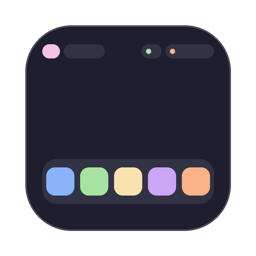
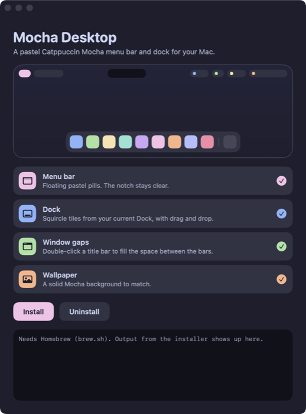

<p align="center"></p>

<h1 align="center">Mocha Desktop</h1>

<p align="center">A pastel <a href="https://catppuccin.com">Catppuccin Mocha</a> menu bar and dock for macOS, built on <a href="https://github.com/FelixKratz/SketchyBar">SketchyBar</a>.</p>

<p align="center"></p>

## What you get

**Menu bar**
- Pastel pills: Apple menu, current app, Amphetamine, volume, Wi‑Fi, battery, and date and time
- They sit on a strip cut from the top of your own wallpaper (it follows dynamic wallpapers through the day), so the bar blends into the desktop while covering Apple's menu bar
- The notch stays empty, so apps that live there aren't covered
- Click the current app to hide it, hide the others or quit it
- Click the clock for Calendar or battery for its settings
- Click Wi‑Fi for a menu to turn it off or on, or open its settings
- Click volume to mute; scroll over it to change the volume
- If [Amphetamine](https://apps.apple.com/app/amphetamine/id937984704) is installed, click the cup to keep your Mac awake for a while or until you turn it off, and optionally with the lid closed
- The Apple menu has Settings, Activity Monitor, Reload bars, Lock screen and Sleep
- Need Apple's own menu bar (File, Edit…)? Press **Control‑Option‑Command‑M**, or pick **macOS Menu Bar** in the Apple menu. The Mocha bar steps aside and comes back once you're done
- Menus close when you click anywhere else

**Dock**
- Squircle tiles in pastel colors, built from the apps already in your Dock
- Running apps fill in with color; the app in front gets a ring
- Hover to see the app's name; the tile grows without moving the others, and keeps up however fast you move
- Right-click for Open or Quit, Show in Finder, Move left or right, Add app, Remove from Dock
- Drag files onto an app to open them with it, or onto the Trash to delete them
- Slides out of the way for full-screen apps and back when you leave

**Window gaps**
- Double-click a window's title bar to fill the space between the menu bar and dock, with an even 8pt gap all around (uses [Rectangle](https://rectangleapp.com))

**Wallpaper**
- A solid Mocha background

## Install

You need macOS 13 or later and [Homebrew](https://brew.sh).

1. Download **Mocha-Desktop.zip** from the [latest release](../../releases/latest), unzip it and move **Mocha Desktop** to Applications.
2. Open it. The app isn't notarized, so the first time macOS will block it: go to **System Settings → Privacy & Security** and click **Open Anyway**.
3. Pick the parts you want and click **Install**.
4. Finish up:
   - Set **System Settings → Control Center → Automatically hide and show the menu bar** to **Always**, if Apple's menu bar still shows.
   - If you installed window gaps, allow **Rectangle** in **Privacy & Security → Accessibility** and turn on **Launch on login** in its settings.

Prefer the terminal? Clone the repo and run `./install.sh` (or `./install.sh menubar dock` for only some parts).

The installer trusts SketchyBar's official Homebrew tap (`felixkratz/formulae`), installs SketchyBar, the Hack Nerd Font and, for window gaps, Rectangle. Anything it replaces in `~/.config` is kept as a `.backup` copy.

## Make it yours

| What | Where |
|---|---|
| Dock apps, order, icons and colors | Right-click a tile, or edit `~/.config/sketchybar-dock/apps.txt` |
| Tile and hover size | `~/.config/sketchybar-dock/sizes.sh` |
| Colors | `colors.sh` in either config folder (the menu bar strip takes its colors from your wallpaper) |
| Menu bar items | `~/.config/sketchybar/sketchybarrc` |

After editing, use **Reload bars** in the Apple menu.

## Uninstall

Open the app and click **Uninstall**, or run `./uninstall.sh`. It brings back Apple's menu bar, Dock and window zoom, and moves your Mocha settings aside instead of deleting them.

## How it works

- **Menu bar:** a SketchyBar config in `menubar/`, started at login by a LaunchAgent.
  - **Above Apple's menu bar:** macOS slides its auto-hidden menu bar down whenever the pointer nears the top, and on macOS 27 it also keeps an invisible window there that takes clicks. Stock SketchyBar can only sit on the same layer, so the menu bar runs a copy built with a one-line change (`menubar/sketchybar/topmost.patch`, built by `scripts/build-sketchybar.sh`) that draws it two layers higher. The bar is a full-width strip, taller than Apple's, so Apple's bar never shows through.
  - **Menu helper:** `menubar/barclick` is a small native helper. It closes the bar's menus on outside clicks, gives back Apple's menu bar on Control‑Option‑Command‑M, hides or quits the current app, and cuts the wallpaper strip (picking the right image of a dynamic wallpaper for the time of day). It also reads and sets the volume through Core Audio, since AppleScript's volume commands take about a second each on macOS 27.
- **Dock:** a second SketchyBar instance in `dock/`, started at login by a LaunchAgent. SketchyBar names each instance after the file it starts from, so the dock runs through a link called `mochadock`.
- **Dock helper:** `dock/dockdrop` is a small native helper that runs alongside the dock.
  - **Hover:** SketchyBar runs a separate script for every mouse enter and exit, all at once, so quick back-and-forth movement made them land out of order and left the wrong tile grown or a name stuck. The helper checks where the pointer is 60 times a second and sends the dock one update, in order, only when the tile under it changes.
  - **Drag and drop:** SketchyBar can't receive drops, so the helper keeps an invisible window over the dock that only catches drops while a file drag is happening.
  - **Menus:** it closes the dock's menus when you click elsewhere.
- **Installer app:** `app/` holds the installer app, which runs `install.sh` and shows its output.

## Build from source

```bash
scripts/build-app.sh 1.0.0
```

This produces `dist/Mocha Desktop.app` and `dist/Mocha-Desktop.zip` (universal, ad-hoc signed). It needs the Xcode Command Line Tools. The build works around a module-map bug in some Command Line Tools releases on its own.

## Credits

Colors from [Catppuccin](https://github.com/catppuccin/catppuccin) (MIT). Bars by [SketchyBar](https://github.com/FelixKratz/SketchyBar) (GPL-3.0; the menu bar uses a patched build, see `menubar/sketchybar/`). Window gaps by [Rectangle](https://github.com/rxhanson/Rectangle). Icons from [Nerd Fonts](https://www.nerdfonts.com).
